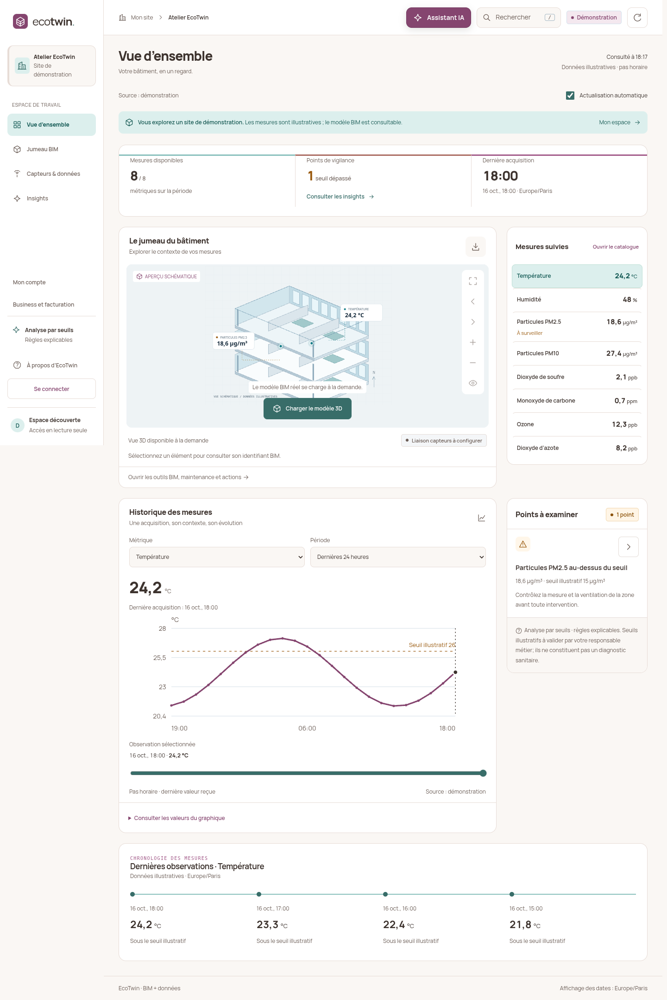

# EcoTwin
Une plateforme de jumeaux numériques pour relier le contexte BIM aux observations du bâtiment et aux décisions d'exploitation.

Le frontend React et TypeScript propose une présentation produit, une connexion réelle, un espace compte, un chatbot OpenAI configurable, une page Business reliée à Stripe et un dashboard responsive avec modèle XKT, huit métriques environnementales, historique, export CSV et insights par règles. Il s'inspire des usages de plateformes comme Autodesk Tandem, avec une identité propre.

## Aperçu


[Présentation, connexion et captures mobiles](docs/product.md) · [Documentation complète](docs/README.md) · [Architecture](docs/architecture.md) · [Déploiement](docs/deployment.md)

Le pilote et ses lots de maintenance livrent 36 tâches. La [migration React](specs/007-react-frontend/spec.md) modernise les interfaces; 7 lots métier restent planifiés. Les observations de démonstration sont illustratives, le modèle XKT est réel et le chatbot OpenAI est configurable mais non activé sans clé et modèle. Voir [les prochaines tâches](specs/001-digital-twin-platform/tasks.md).

## Démarrage
Python 3.11+ (3.12 testé), Node.js 22.12+ et uv.
Depuis la racine du dépôt:
```bash
uv venv .venv --python python3
uv pip sync --python .venv/bin/python --require-hashes api/requirements-dev.lock
npm ci
npm run build
.venv/bin/python -m uvicorn api.src.main:app --host 0.0.0.0 --port 8000
```
Routes: `/business` offre et abonnement Stripe, `/account` compte et mot de passe, `/` présentation, `/login` connexion, `/register` création de compte local, `/dashboard` espace connecté, `/dashboard?mode=demo` découverte publique. Le serveur fournit la distribution `web/dist` et l’API sur la même origine. Exécutez `npm run build` avant de démarrer FastAPI. Aucun compte par défaut: créez explicitement votre compte local.

Le nettoyage et ses mesures sont décrits dans [le lot d’optimisation](specs/001-digital-twin-platform/optimization.md). Les outils historiques se limitent désormais aux fonctions disponibles : BIM, capteurs, maintenance et actions; les panneaux de prédiction et iframes non raccordés ont été retirés.

La démonstration est étiquetée et contient des données illustratives. Le viewer charge le véritable modèle `web/assets/model.xkt` avec un SDK Xeokit figé, servi localement et précompressé pour Nginx. Le lien entre objets BIM et capteurs n'est pas encore configuré.

## Développement frontend

Après le premier build, lancer FastAPI sur le port 8000 puis `npm run dev` dans un second terminal. Vite recharge les composants pendant les modifications et transmet `/api` et `/health` au backend. Les cookies restent HttpOnly et les requêtes passent par le proxy de développement de même origine. Pour vérifier la distribution finale, relancer `npm run build` et utiliser le serveur FastAPI.

Stack : React 19, TypeScript strict, React Router 7 et Vite 8. Les versions exactes sont verrouillées dans package-lock.json. Navigation sans rechargement, filtres partageables, tri du catalogue, sélection d’observation au clavier et scène BIM conservée entre vues. Voir le [plan de migration](specs/007-react-frontend/plan.md).

## Données réelles et configuration
La page connectée ne bascule jamais silencieusement en démo si InfluxDB est absent.
- `INFLUX_URL`, `INFLUX_TOKEN`, `INFLUX_ORG`, `INFLUX_BUCKET`: accès à votre source.
- `API_KEY`: clé pour les producteurs machine, transmise par `X-API-Key`.
- `ECOTWIN_DATA_DIR`: stockage local des comptes, sessions, maintenances et actions; défaut `.runtime/`, ignoré.
- `ALLOW_REGISTRATION`: true pour le développement local; désactiver avant exposition publique.
- `COOKIE_SECURE=true`: requis lorsque servi en HTTPS.
- `CORS_ORIGINS`: origines explicitement autorisées, séparées par virgules, si vous utilisez un frontend séparé.

Le pilote est **mono-site partagé**; les actions sont personnelles, les données de site et la maintenance sont partagées entre comptes autorisés du pilote. Pas d'isolation multi-client ni de SSO pour le moment. Voir [sécurité](docs/security.md).

Télémétrie: `POST /api/telemetry/ingest`, `GET /api/telemetry/latest?sensor=CAP_TEMP`. Les alias `/ingest` et `/latest` restent disponibles avec les mêmes contrôles d'accès. Les écritures sont synchrones et les requêtes Flux paramétrées. Contrat interactif à `/docs`.

Le script `scripts/replay_csv_every_3min_per_metric_no_time.py` utilise uniquement la bibliothèque standard Python. Définissez `CSV_PATH`, `API_KEY`, éventuellement `API_BASE_URL`, `SLEEP_SEC`, `START_INDEX` et `LOOP`. Les identifiants ne sont jamais codés en dur. Sans LOOP, il s'arrête à la dernière ligne.

## Docker
Les deux images se construisent depuis la **racine**:
```bash
docker build -f api/Dockerfile -t ecotwin-api .
docker build -f web/Dockerfile -t ecotwin-web .
docker compose --env-file infra/.env -f infra/docker-compose.yml up -d --build
```
Le frontend Nginx transmet `/api/` à FastAPI. SDK, modèle et routes frontend sont inclus dans les images.
Compose démarre API et web; les profils `telemetry` et `monitoring` ajoutent respectivement InfluxDB et Grafana. Préparer un fichier local à partir de `infra/.env.example` sans écraser un fichier existant; renseigner des identifiants uniques avant l'initialisation des services optionnels.
Les nouveaux volumes Docker remplacent les anciennes données de base versionnées. L'inscription est désactivée par défaut dans Compose et dans l'image API; l'activer uniquement pour un pilote local contrôlé.

Dans un cloud avec proxy TLS géré, conserver la vérification et transmettre le bundle CA au build:
```bash
docker build --secret id=proxy_ca,src=/etc/ssl/certs/ca-certificates.crt -f api/Dockerfile -t ecotwin-api .
```
Le certificat est monté pendant l'installation et n'est pas embarqué dans l'image.

## Tests
```bash
npm run build
.venv/bin/python -m pytest api/tests -q
.venv/bin/python -m ruff check api/src api/tests
.venv/bin/python -m ruff format --check api/src api/tests
npm run check
npm run format:check
npm run test:unit
npx playwright install chromium
npm run test:e2e
```
Playwright lance un serveur isolé sur le port 8010 et stocke ses comptes dans `test-results/runtime`; aucun compte de test n'est créé dans le stockage normal. `CHROMIUM_PATH` permet de choisir un navigateur système, `ECOTWIN_PYTHON` l'interpréteur. `ECOTWIN_E2E_URL` cible un serveur de test existant (par exemple les images Docker), jamais une instance de production.
Le test InfluxDB réel exige `ECOTWIN_TEST_INFLUX_URL` pointant vers une instance **neuve et jetable** d'InfluxDB 2. Il initialise cette instance avec des identifiants de test éphémères et vérifie ingestion/lecture/dashboard. Sans ce paramètre, ce seul test est explicitement ignoré.
CI: [.github/workflows/ci.yml](.github/workflows/ci.yml), avec un service InfluxDB jetable et vérifications navigateur. Voir [preuves de vérification](docs/verification.md).

## Spec Kit et prochaines tâches
Le dépôt est initialisé avec la CLI officielle GitHub Spec Kit et l'intégration Codex.
- [Constitution](.specify/memory/constitution.md): principes de données, sécurité, accessibilité et livraison.
- [Spécification](specs/001-digital-twin-platform/spec.md): parcours et critères d'acceptation.
- [Plan](specs/001-digital-twin-platform/plan.md): architecture et frontières du pilote.
- [Tâches](specs/001-digital-twin-platform/tasks.md): état livré et lots futurs.
- [Design](DESIGN.md) et [contrat UX](UX-CONTRACT.md): identité et comportements partagés.

Dans Codex, les compétences locales `$speckit-specify`, `$speckit-plan`, `$speckit-tasks`, `$speckit-implement` et `$speckit-analyze` permettent de poursuivre le travail. La sélection actuelle est dans `.specify/feature.json`.
```bash
.specify/scripts/bash/check-prerequisites.sh --json --require-tasks --include-tasks
```
Les prochains lots couvrent multi-sites/RBAC/SSO, import et mapping IFC-capteur, connecteurs IoT, IA avec preuves et validation humaine, puis notifications et exploitation. Le chatbot OpenAI configurable complète les règles de seuil; ces règles ne deviennent pas des prédictions IA.

## Structure
- `api/src/`: FastAPI, sécurité, stockage et données.
- `web/src/`: composants et pages React TypeScript; `web/dist/`: distribution générée; `web/public/index.html`: outils BIM avancés historiques.
- `infra/`: Compose et reverse proxy.
- `api/tests/`, `tests/e2e/`: tests API et navigateur.
- `specs/`, `.specify/`, `.agents/skills/`: workflow Spec Kit.
- `docs/`: sécurité, intégration IA et validation.

Les fichiers secrets et les anciens fichiers internes InfluxDB sont retirés du suivi Git en préservant les copies locales. L'historique Git n'est pas purgé: la vérification et la rotation des anciens identifiants restent nécessaires avant production.

## Contribuer et suivre les évolutions
Voir [CONTRIBUTING.md](CONTRIBUTING.md) et [CHANGELOG.md](CHANGELOG.md). Les changements de ce pilote sont publiés via Git; aucune mise en production automatique n’est configurée.

Méthode UI : [huit méthodes de conception et de validation](docs/design-workflow.md).

Méthodes fournies : [références et application du ZIP codex-skills](docs/references/codex-skills/README.md). Le dashboard dispose désormais d’une recherche rapide (`/`), d’une pause de l’actualisation automatique et d’une réinitialisation des filtres.

## Comptes, assistant et Business

Connexion et inscription locales réelles, espace compte et changement de mot de passe avec révocation de toutes les sessions. Le chatbot OpenAI utilise un modèle choisi côté serveur, un accord explicite avant envoi des mesures et des quotas persistés. La page Business lit un prix récurrent Stripe, ouvre Checkout et le portail de facturation; les événements webhook sont signés et le statut est relu chez Stripe.

Aucun tarif ni modèle n’est choisi à votre place. Sans configuration, l’assistant et les abonnements affichent leur indisponibilité. Aucune carte ne passe par EcoTwin. L’abonnement n’étend pas les droits du pilote mono-site.

Configuration : `ECOTWIN_OPENAI_API_KEY`, `OPENAI_MODEL`, `STRIPE_SECRET_KEY`, `STRIPE_WEBHOOK_SECRET`, `STRIPE_PRICE_ID`, `APP_URL`; mode test par défaut. Voir [assistant IA](docs/ai-integration.md), [paiements et activation](docs/billing.md), [spécification](specs/008-auth-ai-business/spec.md) et [tâches](specs/008-auth-ai-business/tasks.md). Exemples sans secrets dans infra/.env.example.

Palette terracotta/turquoise/prune fournie par l’utilisateur, couleurs de texte adaptées au contraste, courbes animées, dialogue avec réduction des mouvements et chronologie synchronisée aux observations. Aucun modèle Figma n’a été importé.
