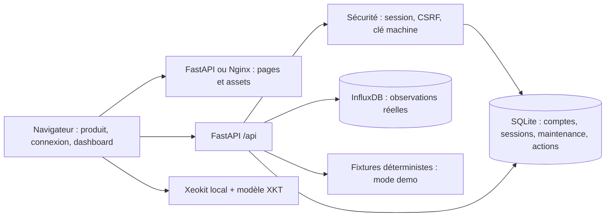

# Architecture EcoTwin

## Périmètre livré
Monolithe modulaire FastAPI, frontend React/TypeScript construit par Vite et SDK Xeokit local figé. L'application peut être servie intégralement par FastAPI ou via un frontend Nginx avec proxy vers l'API. Aucun WebSocket, pipeline ML, service d'import IFC ou orchestration Kubernetes n'est implémenté.

## Frontend
- `web/index.html` et `web/src/main.tsx` sont les entrées Vite; `App.tsx` charge les pages React à la demande avec React Router.
- `web/src/components/ui.tsx` possède les primitives; `pages/Auth.tsx` possède la validation des formulaires.
- `components/TrendPanel.tsx`, `SensorTable.tsx` et `InsightsPanel.tsx` possèdent leur interaction; le SVG est déclaratif et propose une sélection d’observation accessible au clavier.
- `components/BimPanel.tsx` possède les états et commandes React; `lib/bim-engine.ts` possède les objets GPU, les événements et leur destruction. Le SDK reste chargé à la demande.
- `lib/useDashboard.ts` gère les requêtes annulables, le polling et les pannes. `types.ts` décrit les contrats; `api.ts` conserve cookies et header CSRF.
- `web/styles/platform.css` possède les tokens; `web/src/react.css` adapte la composition aux composants; `web/src/dashboard.css`, `web/src/theme.css` (thèmes clair/sombre) et `web/src/workspace.css` (barre supérieure, atelier 3D, barre temporelle), chargés avec la route, possèdent le poste de surveillance et les tokens du rail de navigation.
- `web/public/index.html` conserve les outils historiques de mesure et les éditeurs maintenance/actions.
- `npm run build` vérifie TypeScript puis construit `web/dist` : routes en chunks JS minifiés, CSS, assets utiles, SDK local et sa version gzip. Le fichier IFC source n’est pas copié. `web/dist` et `web/vendor` sont générés et ignorés.
- FastAPI et Nginx servent cette même distribution; Node est nécessaire au build et au développement, pas à l’exécution en production.

Les paramètres URL restaurent métrique, période, vue, recherche, état et tri du catalogue. Un appel dashboard regroupe les observations; actualisation toutes les 30 secondes lorsque l'onglet est visible et que l’actualisation automatique est activée. Les réponses supersédées sont annulées. Les rafraîchissements mettent à jour les panneaux de données en conservant scène BIM, filtres et table ouverte. Dans les outils historiques, un cache mémoire de 30 secondes mutualise les lectures en cours et est invalidé après sauvegarde; seul l’onglet actif est actualisé. Une panne conserve les dernières données avec un état périmé. Les graphiques n'interpolent pas les heures absentes.

## API et stockage
- `core/security.py` : hash scrypt, sessions opaques hachées en base, protection CSRF, garde d'accès session/clé.
- `routers/auth.py` : inscription locale contrôlable, connexion, identité et révocation.
- `routers/telemetry.py` : ingestion synchrone et dernière observation; paramètres Flux séparés du texte de requête.
- `routers/dashboard.py` et `services/dashboard_service.py` : mode demo public ou source live authentifiée; historique horaire et règles de seuil.
- `routers/operations.py` : maintenance partagée du site et actions personnelles persistantes.
- `core/database.py` : initialisation SQLite dans `.runtime/` ou `ECOTWIN_DATA_DIR`.

SQLite et InfluxDB répondent à des besoins différents : état transactionnel du pilote et séries temporelles. Le modèle de données et les [contrats](../specs/001-digital-twin-platform/contracts/api.md) précisent les entités et autorisations.

## Confiance et accès
Le cookie HttpOnly SameSite strict expire après huit heures et peut être révoqué. Les écritures navigateur requièrent un header spécifique et une origine autorisée si elle est fournie. Les producteurs machine envoient `X-API-Key`, jamais une clé dans l'URL.
Les comptes partagent le site du pilote; les actions sont filtrées par auteur. Cette architecture ne fournit pas l'isolation multi-tenant. L'inscription doit être désactivée avant exposition publique, et le cookie marqué Secure en HTTPS.

## Démo, règles et IA
Le mode demo produit des observations illustratives déterministes clairement étiquetées. Il ne sert jamais de remplacement silencieux à une source réelle en panne. Les insights actuels sont des comparaisons à des seuils illustratifs, pas des prédictions IA.
Le mapping BIM n’est pas encore implémenté; le fichier vide sans usage a été supprimé. Multi-sites, IAM/SSO, mapping IFC-capteur et analyses IA avec preuves vérifiées sont suivis dans [tasks.md](../specs/001-digital-twin-platform/tasks.md).

## Déploiement et CI
Les Dockerfiles utilisent le contexte racine du dépôt et incluent scripts, styles, SDK et modèle XKT. Le fichier IFC source reste dans Git mais est exclu des images et du contexte de build, car aucun import IFC n’est implémenté. L'API tourne avec un utilisateur non privilégié; les fichiers copiés appartiennent aux utilisateurs qui doivent les lire. Nginx transmet `/api/` sans changer les chemins.
Compose utilise des volumes nommés. InfluxDB et Grafana sont optionnels via profils. La CI exécute lint, format, tests API avec InfluxDB jetable et tests navigateur; elle ne publie pas automatiquement d'images et ne déploie pas le produit.

Décision et critères de migration : [specs/007-react-frontend](../specs/007-react-frontend/plan.md).

Le dashboard utilise Manrope variable depuis le paquet verrouillé @fontsource-variable/manrope. Vite produit les fichiers WOFF2 locaux avec le chunk de route; la licence est distribuée sous assets/manrope-OFL.txt. Les pages publiques conservent la police système. La grille de composition utilise CSS et garde le canvas React monté entre vues.

## Comptes, IA et facturation
`routers/assistant.py` possède le fournisseur et les quotas, `routers/business.py` les prix/Checkout/Portal/webhooks, `routers/auth.py` le changement de mot de passe. Les tables billing/billing_events/usage_limits sont additives. La source d’état d’abonnement reste Stripe; les événements ne peuvent attribuer de droits par leur ordre d’arrivée. Conversations uniquement en mémoire du composant Assistant. Les pages Account/Business sont chargées par route; aucun changement des frontières de la scène Xeokit. Voir [plan 008](../specs/008-auth-ai-business/plan.md).
