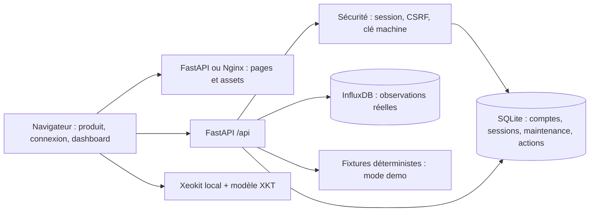

# Architecture EcoTwin

## Périmètre livré
Monolithe modulaire FastAPI, frontend JavaScript ESM/CSS et SDK Xeokit local figé. L'application peut être servie intégralement par FastAPI ou via un frontend Nginx avec proxy vers l'API. Aucun WebSocket, pipeline ML, service d'import IFC ou orchestration Kubernetes n'est implémenté.

## Frontend
- `web/index.html` est le point d'entrée pour `/`, `/login`, `/register` et `/dashboard`.
- `web/js/platform.js` possède navigation, formulaires, récupération des données, graphique SVG, table alternative, export et états de panne.
- `web/js/bim-viewer.js` possède une scène WebGL chargée à la demande. Aucun capteur n'est placé sur un objet sans mapping vérifié.
- `web/styles/platform.css` implémente les tokens décrits dans [DESIGN.md](../DESIGN.md).
- `web/public/index.html` conserve les outils historiques de mesure et les éditeurs maintenance/actions.
- `npm run build` copie la distribution Xeokit installée depuis le lockfile dans `web/vendor/`. Ce dossier généré est ignoré; il n'y a pas de bundle applicatif ni de minification annoncée.

Les paramètres URL restaurent métrique, période, vue et recherche. Un appel dashboard regroupe les observations; actualisation toutes les 30 secondes lorsque l'onglet est visible. Les réponses supersédées sont annulées. Une panne conserve les dernières données avec un état périmé. Les graphiques n'interpolent pas les heures absentes.

## API et stockage
- `core/security.py` : hash scrypt, sessions opaques hachées en base, protection CSRF, garde d'accès session/clé.
- `routers/auth.py` : inscription locale contrôlable, connexion, identité et révocation.
- `routers/telemetry.py` : ingestion synchrone et dernière observation; paramètres Flux séparés du texte de requête.
- `routers/dashboard.py` et `services/dashboard_service.py` : mode demo public ou source live authentifiée; historique horaire et règles de seuil.
- `routers/operations.py` : maintenance partagée du site et actions personnelles persistantes.
- `core/database.py` : initialisation SQLite dans `.runtime/` ou `ECOTWIN_DATA_DIR`.

SQLite et InfluxDB répondent à des besoins différents : état transactionnel du pilote et séries temporelles. Le modèle de données et les [contrats](../specs/001-digital-twin-platform/contracts/api.md) précisent les entités et autorisations.

## Confiance et accès
Le cookie HttpOnly SameSite strict expire après huit heures et peut être révoqué. Les écritures navigateur requièrent un header spécifique et une origine autorisée si elle est fournie. Les producteurs machine envoient `X-API-Key`, jamais une clé dans l'URL.
Les comptes partagent le site du pilote; les actions sont filtrées par auteur. Cette architecture ne fournit pas l'isolation multi-tenant. L'inscription doit être désactivée avant exposition publique, et le cookie marqué Secure en HTTPS.

## Démo, règles et IA
Le mode demo produit des observations illustratives déterministes clairement étiquetées. Il ne sert jamais de remplacement silencieux à une source réelle en panne. Les insights actuels sont des comparaisons à des seuils illustratifs, pas des prédictions IA.
Le fichier de mapping BIM existant est vide. Multi-sites, IAM/SSO, mapping IFC-capteur et fournisseurs IA sont suivis dans [tasks.md](../specs/001-digital-twin-platform/tasks.md).

## Déploiement et CI
Les Dockerfiles utilisent le contexte racine du dépôt et incluent scripts, styles, SDK et modèle. L'API tourne avec un utilisateur non privilégié; les fichiers copiés appartiennent aux utilisateurs qui doivent les lire. Nginx transmet `/api/` sans changer les chemins.
Compose utilise des volumes nommés. InfluxDB et Grafana sont optionnels via profils. La CI exécute lint, format, tests API avec InfluxDB jetable et tests navigateur; elle ne publie pas automatiquement d'images et ne déploie pas le produit.
