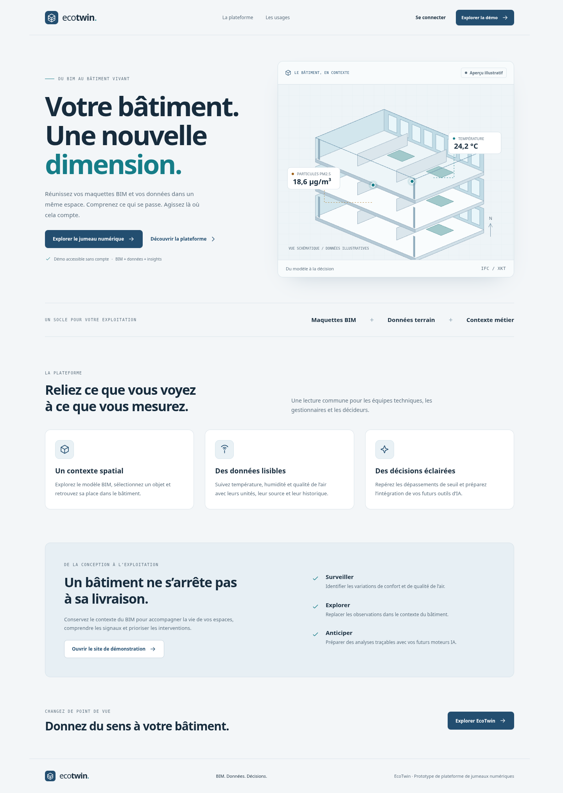
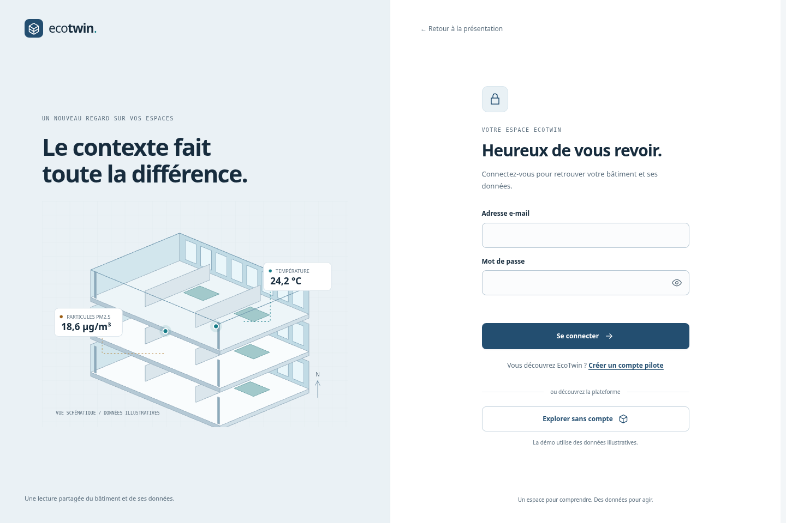

# Le pilote EcoTwin

## Objectif
Donner aux équipes d'exploitation une lecture commune du bâtiment : son contexte BIM, ses observations et les signaux à examiner. L'inspiration fonctionnelle est celle des plateformes de jumeaux numériques comme Autodesk Tandem; EcoTwin conserve sa propre identité et n'est pas affilié à Autodesk.

## Parcours
1. **Découvrir** : la présentation explique BIM, données et décisions; la démo s'ouvre sans compte.
2. **Se connecter** : un compte local du pilote donne accès à l'espace connecté. Aucun compte par défaut, pas de connexion simulée.
3. **Observer** : le dashboard affiche source, dernière acquisition, historique, seuils et états manquants/anciens.
4. **Explorer** : le modèle XKT réel est chargé à la demande. La sélection d'un élément montre son identifiant BIM sans inventer de correspondance capteur.
5. **Examiner** : les insights expliquent les dépassements observés. Les observations affichées sont exportables en CSV.

## Interfaces
Les captures montrent la démonstration, avec des valeurs illustratives.

### Présentation

### Connexion

### Dashboard

### Mobile
[Présentation mobile](images/produit-mobile.png) · [Dashboard mobile](images/dashboard-mobile.png)

## Disponibilité
| Fonction | État |
|---|---|
| Présentation, connexion et inscription locale contrôlable | Livré |
| Modèle XKT, navigation et outils de mesure historiques | Livré |
| Huit métriques, historique, filtres et export | Livré |
| Sessions serveur et données réelles via InfluxDB | Livré pour un pilote mono-site |
| Maintenance et actions persistées | Livré dans les outils historiques |
| Insights par seuils explicables | Livré; seuils illustratifs |
| Liaison vérifiée objet BIM-capteur et import IFC | Planifié |
| Multi-sites, RBAC et SSO | Planifié |
| Fournisseur IA, prédictions et validation humaine | Planifié |

Les limites de validation sont décrites dans [verification.md](verification.md). Les lots futurs sont suivis dans [tasks.md](../specs/001-digital-twin-platform/tasks.md).
